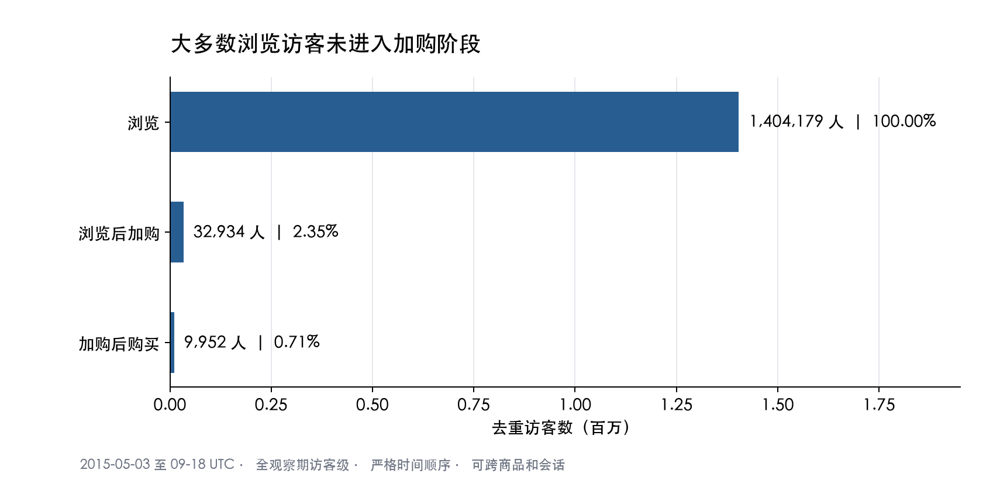
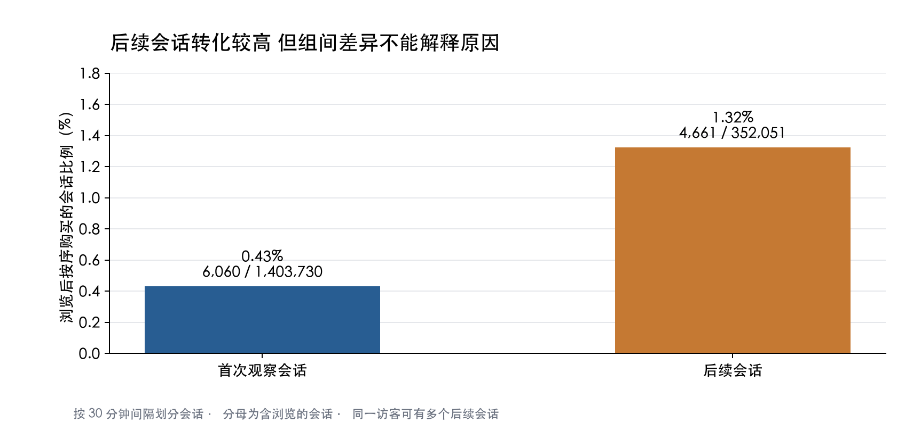
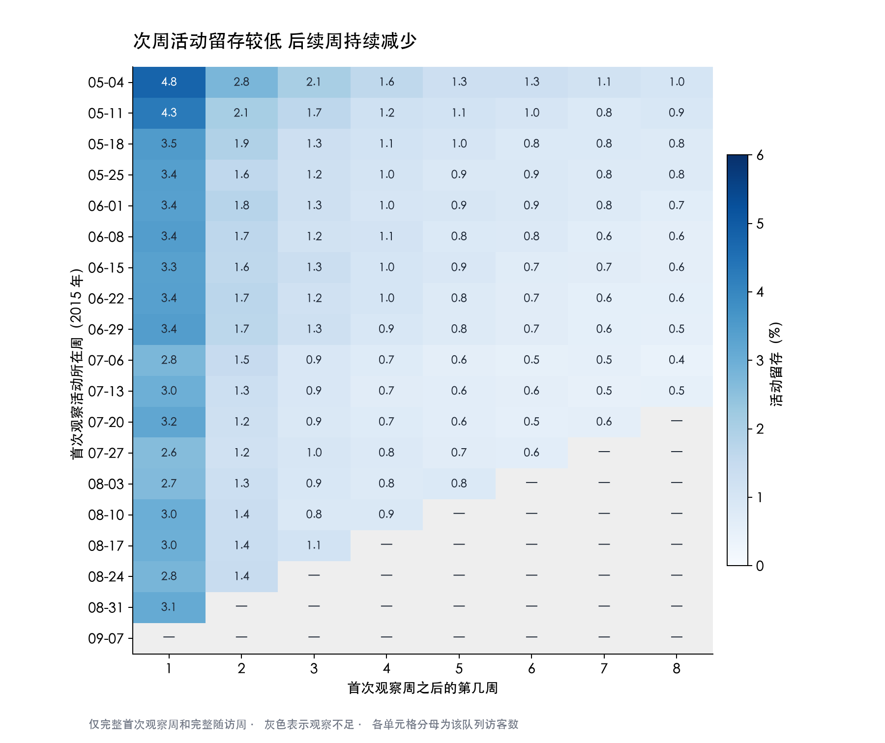
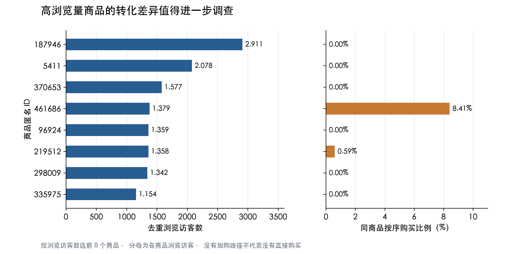

# RetailRocket 电商用户行为与转化分析

**个人项目 · 公开历史数据 · Python / DuckDB SQL / pandas / Matplotlib**

基于 RetailRocket 的电商行为日志，分析访客从浏览到加购、购买的转化路径，以及会话差异、周队列留存和商品表现。代码已在全量数据上运行，并使用 pandas 独立复算关键指标。

[阅读分析报告](docs/analysis-report.pdf) · [查看已执行 Notebook](notebooks/retailrocket_analysis.ipynb) · [查看 SQL](sql) · [验证记录](results/validation.json)

## 核心发现

| 分析问题 | 观察结果 | 口径 |
| --- | --- | --- |
| 浏览后有多少访客加购 | **2.35%** | 32,934 / 1,404,179 位浏览访客 |
| 浏览后有多少访客完成顺序购买 | **0.71%** | 9,952 / 1,404,179；要求浏览、加购、购买时间严格递增 |
| 首次观察与后续会话有何差异 | **0.43% vs 1.32%** | 含浏览会话内的严格顺序购买比例；属于观察性比较 |
| 次周是否再次活跃 | **3.28%** | 42,465 / 1,295,569；只纳入完整首次观察周及完整随访周 |
| 首次观察后七天内是否购买 | **0.75%** | 10,165 / 1,348,273；每位访客至少有完整七天观察 |

浏览后加购的通过比例较小，值得优先调查行为路径和日志覆盖。高浏览商品之间的购买表现也有差异，可进一步补充可购买状态、页面和用户调研证据。以上结果用于提出调查方向与实验假设，没有线上实施或已实现的转化、收入提升。

### 访客转化漏斗



主漏斗为全观察期访客口径，可跨会话与商品，不等于同一次购物流程。补充同商品严格口径后，完成顺序购买的访客为 9,641 位。没有经过加购路径，不代表没有直接购买。

### 首次观察会话与后续会话



分组在会话开始时确定，同一访客可以贡献多个后续会话。首次观察不能确认是真实新客，后续会话转化较高也不能证明回访导致转化提升。

### 完整周队列留存



以 UTC 自然周分组，排除不完整进入周与不完整随访周，观察不足的单元格不按零处理。各周龄的合格队列不同，加权数列不能视为同一批访客的纵向轨迹。

### 高浏览商品对比



按去重浏览访客数选择前八个商品展示，另提供浏览访客不少于 1,000 的十二个商品的完整结果。没有价格、库存或页面字段，因此不会把购买差异直接归因于某一因素。

## 数据与方法

- **来源**：[RetailRocket 在 Kaggle 发布的电商数据](https://www.kaggle.com/datasets/retailrocket/ecommerce-dataset)，仅使用 `events.csv`。
- **窗口**：2015-05-03 至 2015-09-18 UTC；历史数据不代表当前平台或行业表现。
- **规模**：原始 2,756,101 条，移除 460 条完全重复记录，清洗后 2,755,641 条，覆盖 1,407,580 位匿名访客。
- **字段**：毫秒时间戳、访客 ID、事件类型、商品 ID、交易 ID。
- **会话**：按访客排序，相邻事件间隔超过三十分钟开启新会话；使用 `LAG` 与累计 `SUM`。
- **顺序**：主漏斗要求严格递增时间，不对同毫秒不同事件强行排序。
- **留存**：合格队列活跃访客总和 / 队列访客总和，不简单平均队列百分比。

SQL 完成数据准备、分组和指标计算，Python 负责运行流程、可视化及独立核对。研究重点是可解释的行为指标，未使用缺少消费金额的 RFM，也未以预测模型替代指标定义。

## 结果验证

`src/validate.py` 使用另一套 pandas 实现核对：

- 全量去重数量与三步访客漏斗；
- **169** 个周队列留存单元格与固定七天首次购买指标；
- **1,761,675** 次会话的分组和转化；
- **12** 个高浏览商品的浏览、加购、顺序购买及浏览后购买人数。

小型合成测试仅用于验证逆序事件、同毫秒事件、跨商品路径、重复行、会话间隔和队列成熟度，不参与报告中的分析结果。

另进行高活跃访客敏感性分析：暂时排除事件数超过第 99.9 百分位阈值 47 的 1,351 位访客后，浏览→加购为 2.29%，严格顺序浏览→购买为 0.67%。没有仅凭活跃次数认定机器人。

已有执行环境、输入校验和和查询哈希见 [provenance.json](results/provenance.json)，核对结果见 [validation.json](results/validation.json)。这些文件记录全量运行与独立核对；后续重跑会更新执行记录。

## 复现方法

建议 Python 3.12，依赖版本见 `requirements.txt`。从项目根目录运行：

```bash
python -m venv .venv
source .venv/bin/activate          # Windows: .venv\Scripts\activate
python -m pip install -r requirements.txt
python src/download_data.py
python src/run_analysis.py
python src/validate.py
python src/plot_results.py
```

原始数据不上传到 Git；来源、下载方式和许可见 [DATA_SOURCE.md](DATA_SOURCE.md)。下载失败时可手动取得 `events.csv`，再运行：

```bash
python src/run_analysis.py --data /path/to/events.csv
python src/validate.py --data /path/to/events.csv
```

Notebook 已保存八个代码单元的运行输出和四张图。可使用支持 Jupyter 的编辑器打开，或另行安装 JupyterLab：

```bash
python -m pip install jupyterlab
jupyter lab notebooks/retailrocket_analysis.ipynb
```

如需重跑 Notebook，请先将数据放到默认的 `data/events.csv.gz` 路径。图表优先使用本机已安装的中文字体；如果系统没有中文字体，需安装中文字体后重新生成。

## 项目结构

```text
├── README.md
├── DATA_SOURCE.md
├── requirements.txt
├── data/README.md                # 原始数据获取方式
├── docs/analysis-report.pdf       # 完整分析报告
├── notebooks/                    # 已执行 Notebook
├── sql/                          # 十份数据准备与分析查询
├── src/                          # 下载、执行、可视化及验证
└── results/
    ├── figures/                  # 四组 PNG / SVG 图表
    ├── tables/                   # CSV 分析结果
    ├── provenance.json           # 执行与查询记录
    ├── source.json               # 来源与数据校验和
    └── validation.json           # 独立核对记录
```

## 研究范围与参考

这是基于公开数据、由 AI 辅助代码编写和文档整理的个人分析项目。没有用户访谈、线上实验或运营实施成果；匿名访客 ID 不能确认真实身份、注册时间与跨设备关系。数据中也没有收入、成本、投放或人口属性字段。

参考 [product-funnel-activation-sql](https://github.com/jacobmackey01/product-funnel-activation-sql) 的研究问题与指标边界；本项目代码重新编写并在原始数据上运行，新增会话级比较、同商品与高浏览商品分析、固定七天购买、高活跃敏感性分析，以及 pandas 独立核对。数据及衍生输出的来源和许可说明见 [DATA_SOURCE.md](DATA_SOURCE.md)。
