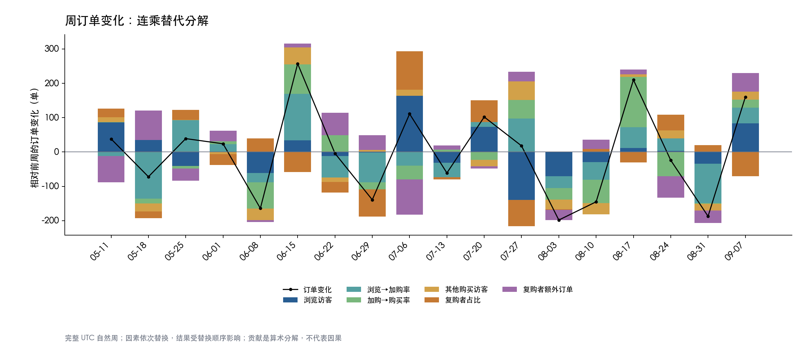

# 订单指标体系与诊断

## 北极星和计算边界

使用购买事件的去重 `transaction_id` 作为订单数，衡量观察到的交易规模。`events.csv` 不含价格、实付、退款、利润或订单状态，无法计算 GMV、净收入或利润；这里的“订单”是交易 ID 代理，并不保证已支付或履约。项目检查同一交易 ID 是否跨访客复用，发现复用即终止，避免访客层订单数之和与全局去重数不一致。

以下为 2015-05-03 至 2015-09-18 UTC 全量数据的计算值（完整精度见 [指标树 CSV](../results/tables/10_metric_tree.csv)）：

| 层级 | 定义 | 实际值 |
|---|---|---:|
| 订单数 | 购买访客 × 人均订单 | 17,672 |
| 购买访客 | 严格路径 + 其他购买路径 | 11,719 = 9,952 + 1,767 |
| 严格路径 | 浏览访客 × 浏览→加购率 × 加购→购买率 | 1,404,179 × (32,934 / 1,404,179) × (9,952 / 32,934) = 9,952 |
| 人均订单 | （单次购买者订单 + 复购者订单）/ 购买访客 | (10,656 + 7,016) / 11,719 = 1.508 |
| 单次 / 复购 | 期间分别购买 1 单 / 超过 1 单 | 10,656 人 / 1,063 人 |
| 复购订单 | 复购者贡献的全部订单 | 7,016 单；人均约 6.600 单 |

严格路径要求浏览、加购、购买时间严格递增，可跨商品、跨会话；与 `02_funnel` 一致。其他路径是所有购买访客减去严格路径购买访客，包括直接购买、逆序、同毫秒事件、缺失行为等，不能全部认定为直接购买。单次与复购按观察窗口中的不同交易 ID 数划分；复购者组根据事后行为定义，不能当作干预分组。

业务解释：浏览人数近似流量入口；浏览→加购可提示商品页、推荐和商品吸引力的问题；加购→购买可提示结算支付流程的调查方向；复购人数占比和频次关注再次购买。数据没有曝光、推荐位、支付失败等字段，这些环节仅是待验证的排查方向。

## 周度树和因素分解

[周度结果](../results/tables/11_metric_tree_weekly.csv)按 UTC 周一零点至下周一零点分组，每周独立识别严格路径和该周购买频次。跨周行为不会组成周内严格路径；“复购者”指同一周超过一单，而不是历史首次购买后的回购。因此周度人数、路径和复购者不能加总还原全期人数。首尾观察不足的周标记 `is_complete=false`，仅连续两个完整周计算变化；没有可比前周的贡献为空，不填零。

令 `V` 为浏览访客，`a` 为浏览→加购率，`b` 为加购→购买率，`N` 为其他购买路径人数，`s` 为购买者中周内复购者占比，`f` 为复购者人均额外订单（复购者人均订单减一），则：

`订单 = (V × a × b + N) × (1 + s × f)`。

连乘替代依次将 `V, a, b, N, s, f` 从前周替换为本周，每次公式之差即对应因素贡献。所有贡献严格加总为订单变化；顺序影响单项归因，零分母时比率及额外订单约定为零，确保公式在无购买周仍可计算。分解是算术归因，不证明业务原因。CSV 的 `*_reconciliation` 为对账残差，`decomposition_reconciliation` 为订单变化减各因素贡献之和；浮点数容差 1e-7。

例：6 月 15 日当周相对前周增加 257 单，其中浏览→加购率贡献约 +135.4 单、加购→购买率约 +85.7 单，复购者占比约 −58.2 单，其余因素共同作用。8 月 3 日当周减少 198 单，其中浏览访客约 −70.7 单。由于因素替换顺序及其他同时变化的影响，这些数值不代表通过调整某个环节就会产生相同增量。

## 过程指标、护栏和下钻

- **过程指标**：首次观察会话与后续会话的含浏览会话顺序购买率分别为 0.43%、1.32%（`04_sessions.csv`）；成熟访客首次观察后七天内购买率为 10,165 / 1,348,273 = 0.75%（`06_activation.csv`）。首次观察不等于真实新客。
- **护栏**：原始 2,756,101 行、完全重复 460 行、清洗后 2,755,641 行（`01_quality.csv`）；排除事件数超过 47 的高活跃访客后严格浏览→购买为 0.67%，作为敏感性分析而非机器人识别（`09_activity_sensitivity.csv`）；完整队列的加权次周活跃留存为 42,465 / 1,295,569 = 3.28%（`retention_weighted.csv`）。
- **下钻维度**：匿名商品 ID 的同商品漏斗见 `07_products.csv`；首次/后续观察会话见 `04_sessions.csv`；首次观察进入周及后续周留存见 `05_retention.csv`。这些表用于分维度排查，不是可直接加总的同一棵树：访客可能跨商品、跨会话或跨周出现。

| 哪一层变化 | 优先查什么 | 当前数据能否验证原因 |
|---|---|---|
| 浏览访客 | 进入周、商品浏览分布及采集覆盖 | 可比较行为；无曝光、渠道和投放数据 |
| 浏览→加购率 | 同商品漏斗、首次与后续会话、页面和推荐 | 可比较前两项；无页面、推荐和库存信息 |
| 加购→购买率 | 商品和会话漏斗、顺序及事件缺失 | 无结算步骤、支付失败或价格字段 |
| 其他购买访客 | 无浏览/加购、逆序及同毫秒路径、埋点覆盖 | 可复核日志，不能断言都是直接购买 |
| 复购占比或额外订单 | 分周频次、高活跃敏感性、进入周留存 | 可描述分布；不能判断活动或用户动机 |

匿名访客不等于真实个人；仅观察到数据窗口内的行为，可能存在左截断和右截断。跨商品漏斗不是单件商品购买路径，留存是再次发生任意事件，不等于复购。指标变化、群组差异和因素贡献均不构成因果关系或运营成效。
